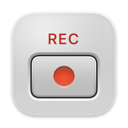
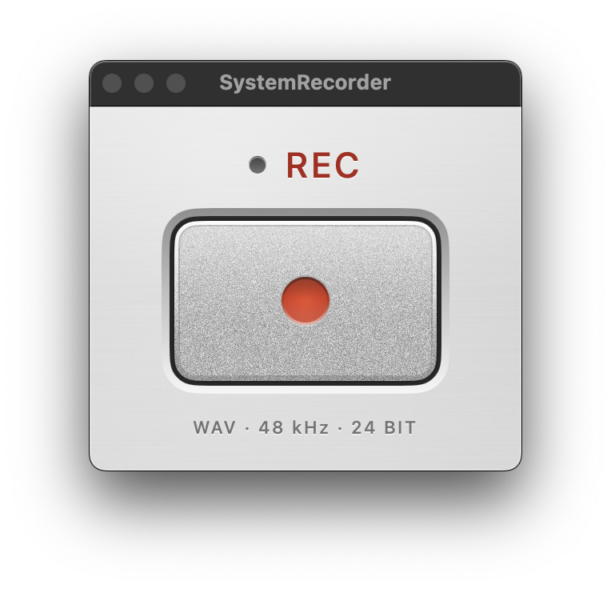
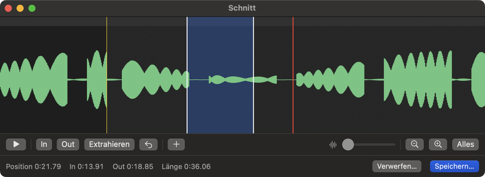

<h1 align="center">&nbsp;&nbsp;SYSTEMRECORDER</h1>

<p align="center"><code>window app</code>&nbsp;&nbsp;<code>macOS 13+</code>&nbsp;&nbsp;<code>free · GPL-3.0</code></p>

<p align="center">☕ If you use SystemRecorder and like it, I would be glad if you <a href="https://buymeacoffee.com/moritzpoth">bought me a coffee</a>.</p>

A tiny macOS app that records whatever your Mac is playing – a browser tab, a video call, a player – straight to a WAV file, 48 kHz / 24 bit. One big REC key, no drivers, no audio routing.

After you stop, a small editor opens: trim the recording, cut out what you don't need, add other audio files and put the pieces in order before you save.

<p align="center"></p>

*The app's interface is in German.*

> Please report problems in [Issues](../../issues).

## Features

- **Records the system audio** – everything that plays on the Mac, through ScreenCaptureKit. No extra driver (like BlackHole or Loopback) and no change to your sound output. SystemRecorder's own sounds are left out.
- **WAV, 48 kHz / 24 bit** – the format editing programs expect.
- **Edit before saving** – after *Stopp* the window *Schnitt* opens. Nothing is written to your disk until you click *Speichern…*; until then the recording is a temporary file.
- **Cut** – set In and Out, *Extrahieren* removes that part and closes the gap. ⌘Z undoes every step.
- **J / K / L** as in editing programs: L plays forward, J backwards, pressing again plays faster (2×, 4×); K stops. Hold K and tap J or L to step one frame.
- **Add audio files** – *+* appends one or more audio files (WAV, AIFF, MP3, M4A …) at the end of the timeline. They are converted to the recording's format; your original files are never changed.
- **Move clips** – every piece of the timeline is a clip: the recording, each added file and each part left over after a cut. Drag a clip with the mouse to put it somewhere else; the other clips make room.
- **Safe** – closing the editor window or quitting asks whether to save or discard the recording. Quitting during a recording asks too.

## Usage

<p align="center"></p>

1. Click the REC key (or press the space bar). The LED lights up while SystemRecorder records.
2. Click it again to stop. The editor opens.
3. Edit, then *Speichern…* and choose where the WAV goes – or *Verwerfen…* to delete the recording.

| Key | Action |
|---|---|
| Space | play / pause |
| J · K · L | backwards · stop · forwards (again = faster) |
| K + J / K + L, ← / → | one frame (25 fps) back / forward, with sound |
| I · O | set In · Out |
| X | extract In to Out (no In = from the start, no Out = to the end) |
| ⌘Z | undo |
| ⌘+ · ⌘− · ⌘0 | zoom in · out · whole recording |

- **Click** in the waveform to move the playhead. **Drag** a clip to move it. To scrub, drag in the narrow strip at the top of the timeline.
- The slider next to the zoom buttons makes the waveform taller, for quiet recordings.

## Requirements

- macOS 13 Ventura or later, Apple Silicon or Intel

## Install

1. Download `SystemRecorder-<version>.dmg` from [Releases](../../releases) and open it.
2. Drag `SystemRecorder.app` onto the **Programme** (Applications) folder in the window that opens.

<p align="center"></p>

### First launch: “Apple could not verify …”

SystemRecorder is open source and is not signed with a paid Apple Developer certificate. macOS therefore blocks the first launch. You only need to allow it **once**:

1. Double-click `SystemRecorder.app`. macOS shows a warning – click **Done** (or **OK**).
2. Open **System Settings → Privacy & Security**.
3. Scroll down to *“SystemRecorder” was blocked …* and click **Open Anyway**.
4. Confirm with your password and click **Open Anyway** again.

Alternatively, in Terminal:

```
xattr -dr com.apple.quarantine /Applications/SystemRecorder.app
```

### Permission to record

The first recording asks for permission: macOS treats recording system audio like screen recording. Allow SystemRecorder under **System Settings → Privacy & Security → Screen & System Audio Recording** (macOS 13/14: *Screen Recording*) and start SystemRecorder again. SystemRecorder only records sound, never the screen.

## Build

Requires the Xcode Command Line Tools.

```
./build.sh     # → SystemRecorder.app (universal, ad-hoc signed)
./dmg.sh       # → SystemRecorder.dmg (download image with window layout; asks once for Finder automation)
```

`SystemRecorder.app/Contents/MacOS/SystemRecorder --edit file.wav` opens a copy of a WAV in the editor without recording.

## License

GPL-3.0-or-later – see [LICENSE](LICENSE). © 2026 Moritz Poth. Comes without any warranty.
